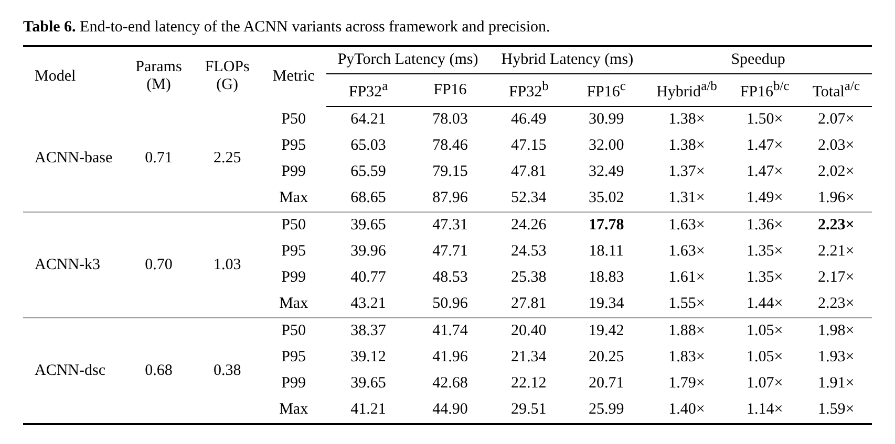

# Hybrid TensorRT–PyTorch Inference Acceleration

**Hybrid TensorRT–PyTorch Inference Acceleration for Attention-Based CNNs with Dynamic ROI Sampling: A Case Study on Jetson Nano**

Hyun-Yong Kim (Chungbuk National University)

➡️ [Read the preprint on Preprints.org](https://doi.org/10.20944/preprints202611.0026.v1) (DOI: 10.20944/preprints202611.0026.v1)  
➡️ Base model: [Attention-based CNN (A-CNN)](https://github.com/kimhy365/AttentionCNN), IEEE TIM 2025

## 📚 Overview

TensorRT speeds up inference through layer fusion, lower precision and kernel auto-tuning. However, a model with even one unsupported operator cannot be compiled into a single TensorRT engine.

Our [A-CNN](https://github.com/kimhy365/AttentionCNN) extracts a region of interest (ROI) with `affine_grid()` and `grid_sample()`. These operators are not supported by the toolchain available on the Jetson Nano (JetPack 4.6, TensorRT 8.0.1, torch2trt).

This repository provides a **hybrid TensorRT–PyTorch deployment**:

- The **localization network (LN)** and **classification network (CN)** are compiled into TensorRT engines with torch2trt.
- The **ROI sampler** (only about 0.45 MFLOPs) falls back to native PyTorch.
- You don't need to write custom CUDA kernels or TensorRT plugins.

Key contributions:

- A hybrid TensorRT–PyTorch pipeline for A-CNN variants on the legacy Jetson Nano, using the graph-partitioning and PyTorch-fallback idea.
- A latency analysis of the full pipeline across preprocessing, device (CPU/GPU), framework (PyTorch/TensorRT) and precision (FP32/FP16).
- Evidence that lower FLOPs do not always mean lower latency: depthwise separable convolution (DSConv) gains little or nothing from TensorRT FP16 on the Jetson Nano.

## 🔧 Hybrid Inference Pipeline

```
frame ─► Preprocess (GPU) ─► LN [TensorRT] ─► ROI Sampler [PyTorch] ─► CN [TensorRT] ─► argmax
```

- **Preprocess:** `cv2.cvtColor` runs on the CPU. The raw `uint8` image is then sent to the GPU, where datatype conversion, normalization and layout changes are done.
- **LN variants:** `LN-base` (2.2 GFLOPs), `LN-k3` (0.98 GFLOPs, 3×3 kernels), `LN-dsc` (0.34 GFLOPs, DSConv).
- **Sampler:** `affine_grid()` + `grid_sample()` produce a 96×96 ROI patch.

## 🖥️ Environment

| Item | Version |
|---|---|
| Device | NVIDIA Jetson Nano 4GB (10W MAXN, `jetson_clocks`) |
| OS / Python | Ubuntu 20.04 / Python 3.8 (upgraded from JetPack 4.6) |
| PyTorch | 1.13 |
| CUDA / cuDNN | 10.2 / 8.2 |
| TensorRT | 8.0.1.6 |
| torch2trt | 0.5.0 |
| OpenCV | 4.10 |

## 📊 Results

End-to-end latency of the ACNN variants on the Jetson Nano (Table 6 in the paper). Each value comes from 1,000 steady-state runs and includes preprocessing and postprocessing.

<p align="center"></p>

**Notes:**

- **Hybrid<sup>a/b</sup>** compares PyTorch and hybrid runtimes at the same FP32 precision.
- **FP16<sup>b/c</sup>** is the extra gain from lowering precision inside the hybrid runtime.
- **Total<sup>a/c</sup>** is the overall speedup from PyTorch FP32 to hybrid FP16.
- **Accuracy:**
  - At the same precision, hybrid conversion barely changes accuracy.
  - Reducing precision from FP32 to FP16 added about 2 misclassifications on average, an accuracy drop of about 0.17%p on the 1,200-image test set.

**Highlights:**

- The fastest configuration is **hybrid FP16 ACNN-k3 at 17.78 ms (56.2 fps)**. That is 2.16× faster than the fastest PyTorch model.
- GPU-integrated preprocessing reduced preprocessing time from 5.125 ms (CPU-only, FP32) to 2.116 ms (GPU, FP16), a 2.42× speedup. It also reduced latency jitter.
- Under TensorRT FP16, ACNN-k3 ran faster than ACNN-dsc even though ACNN-k3 has about 3× more FLOPs.

> See the paper for stepwise profiling and CPU–GPU workload analysis.

## 📂 Repository Structure

_Code and instructions will be added._

## 📄 Citation

```bibtex
@article{kim2026hybrid,
  title   = {Hybrid TensorRT--PyTorch Inference Acceleration for Attention-Based CNNs with Dynamic ROI Sampling: A Case Study on Jetson Nano},
  author  = {Kim, Hyun-Yong},
  journal = {Preprints},
  year    = {2026},
  doi     = {10.20944/preprints202611.0026.v1}
}
```

Base model:

Hyun-Yong Kim, Taek-Joon Yi, and Jong-Yun Lee, "An Attention-based Convolutional Neural Network with Spatial Transformer Module for Automated Optical Inspection of Small Objects," *IEEE Transactions on Instrumentation and Measurement*, 2025. DOI: [10.1109/TIM.2025.3548240](https://doi.org/10.1109/TIM.2025.3548240)
